

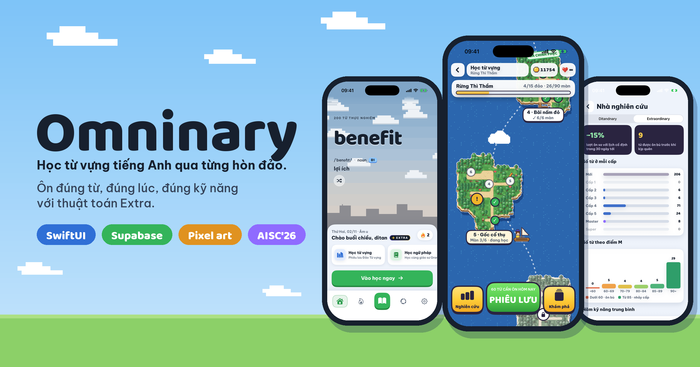

# Omninary

**Học từ vựng tiếng Anh qua từng hòn đảo.**
Ôn đúng từ, đúng lúc, đúng kỹ năng với thuật toán Extra.

---

## Omninary là gì?

Omninary là ứng dụng iOS giúp người Việt học và ôn **từ vựng tiếng Anh**, kèm **ngữ pháp**, **luyện nghe** và **luyện nói**. Mỗi lần ôn là một chuyến phiêu lưu trên những hòn đảo pixel. Mỗi từ được luyện qua năm dạng bài, và app ghi lại *cách* bạn trả lời: nghĩ bao lâu, mở gợi ý nào, nghe lại mấy lần, sai gần hay sai xa. Từ đó, thuật toán **Extra** biết từ nào bạn đã vững, từ nào sắp quên, kỹ năng nào còn yếu.

| | **Ditandnary** (miễn phí) | **Extraordinary** (trả phí) |
|---|---|---|
| Lịch ôn | Nhịp cố định 1 · 3 · 7 · 15 · 30 ngày, rồi Master | Thuật toán **Extra** quyết định riêng cho từng từ |
| Từ sắp quên | Ôn theo lịch chung | **Ôn bù** ngay hôm sau |
| Từ đã vững | Ôn theo lịch chung | **Nhảy cấp**, dời lịch ra xa |
| Kỹ năng yếu | Không thêm câu | **Tăng cường** câu cho đúng kỹ năng đó |
| Nhà nghiên cứu | Thống kê cơ bản | Phân tích đầy đủ: điểm M, 5 kỹ năng, Extra đã tiết kiệm bao nhiêu |

## Tính năng nổi bật

### 🗺️ Lộ trình Phiêu lưu

Bốn vùng đất: Rừng Thì Thầm, Hồ Gương, Phố Chữ, Sa Mạc Vang. Mỗi vùng có 15 hòn đảo, mỗi đảo 6 màn. Thuyền chở bạn qua từng đảo; vào màn, bạn đi tới các nhiệm vụ trên đảo, mỗi nhiệm vụ là một loạt câu hỏi thật của phiên ôn. Trả lời sai thì có nhiệm vụ làm lại cho tới khi thuộc hết. Mọi hòn đảo đều được vẽ bằng engine pixel viết bằng Swift.

<table>
  <tr>
    <td align="center">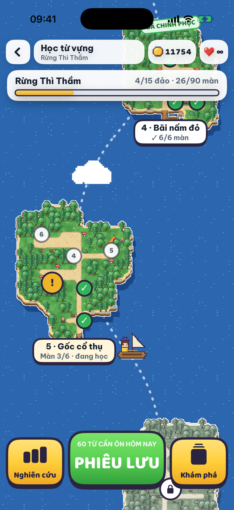 <b>Lộ trình đảo</b></td>
    <td align="center">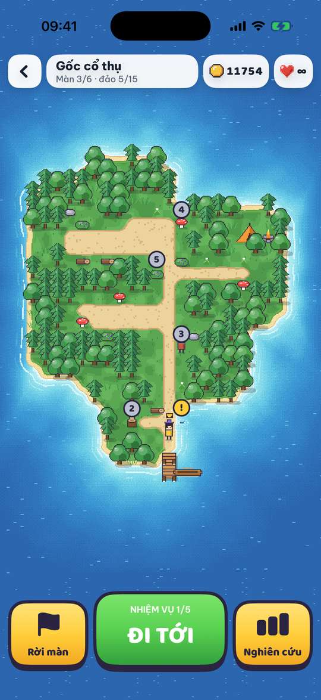 <b>Vào màn</b></td>
    <td align="center">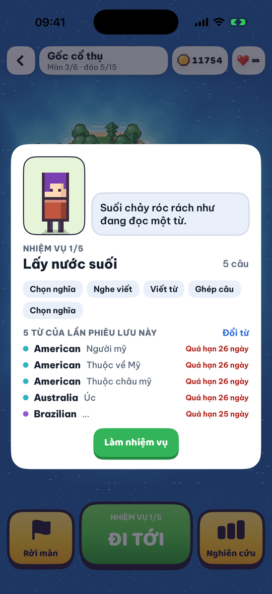 <b>Nhận nhiệm vụ</b></td>
  </tr>
</table>

### 🧩 Năm dạng bài, chấm theo cách bạn trả lời

Nghe rồi viết, đọc nghĩa rồi viết, chọn từ đúng, ghép câu và đọc to câu ví dụ (chấm phát âm bằng Azure Speech). Gợi ý có hai bậc, có một lần nhập lại khi sai, và mỗi hỗ trợ đều được tính vào điểm. Cuối màn, từng thẻ từ được lật lại cùng điểm từng dạng bài, năm kỹ năng và lịch ôn tiếp theo.

<table>
  <tr>
    <td align="center">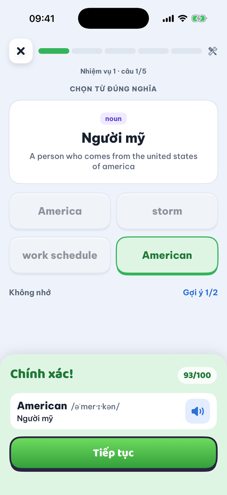 <b>Chọn từ đúng</b></td>
    <td align="center">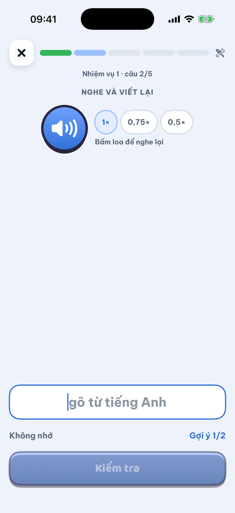 <b>Nghe rồi viết</b></td>
  </tr>
</table>

### 🔬 Nhà nghiên cứu

Tab **Ditandnary** cho thấy số từ ở mỗi cấp và lịch ôn cố định theo đợt học: những từ học cùng ngày cứ đến hạn cùng ngày, nên có hôm phải ôn cả chục từ, có hôm không có từ nào. Tab **Extraordinary** cho thấy Extra sắp xếp lại lịch đó ra sao: số từ theo điểm thông thạo M, radar năm kỹ năng, số từ được nhảy cấp, ôn bù, tăng cường, và số từ phải ôn mỗi ngày so với lịch cố định.

<table>
  <tr>
    <td align="center">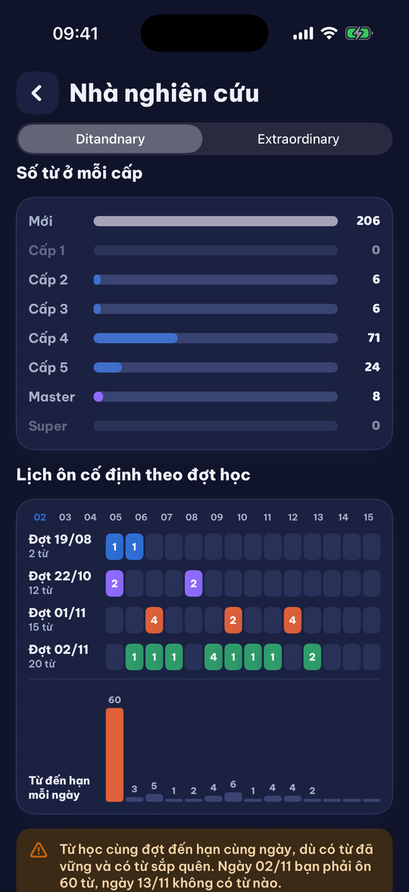 <b>Lịch cố định theo đợt</b></td>
    <td align="center">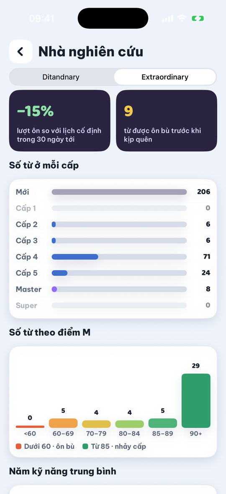 <b>Điểm M và cấp độ</b></td>
    <td align="center">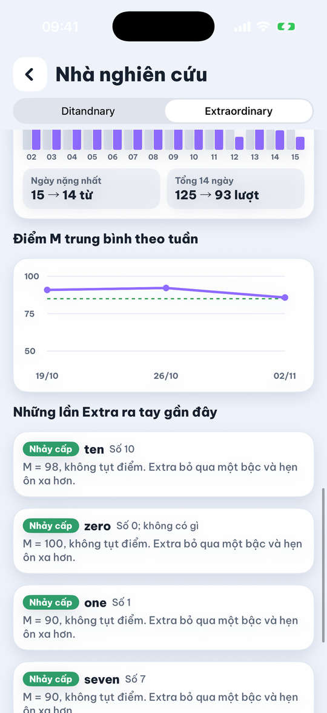 <b>Extra tiết kiệm bao nhiêu</b></td>
  </tr>
</table>

### 🃏 Khám phá: thẻ từ pixel và thẻ giấy

Mỗi nghĩa của từ là một thẻ bài pixel, màu khung theo trình độ CEFR, có sao theo cấp và điểm M. Tab **Khám phá bộ từ** gom các bộ thẻ có sẵn để xem và tải về. Tab **Thêm từ** dành cho thẻ giấy Omninary: nhập mã in ở góc thẻ là mở được thẻ mới, kèm hiệu ứng lật thẻ; hoặc tự thêm từ của bạn.

<table>
  <tr>
    <td align="center">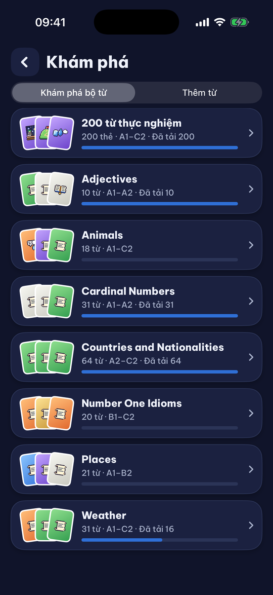 <b>Khám phá bộ từ</b></td>
    <td align="center">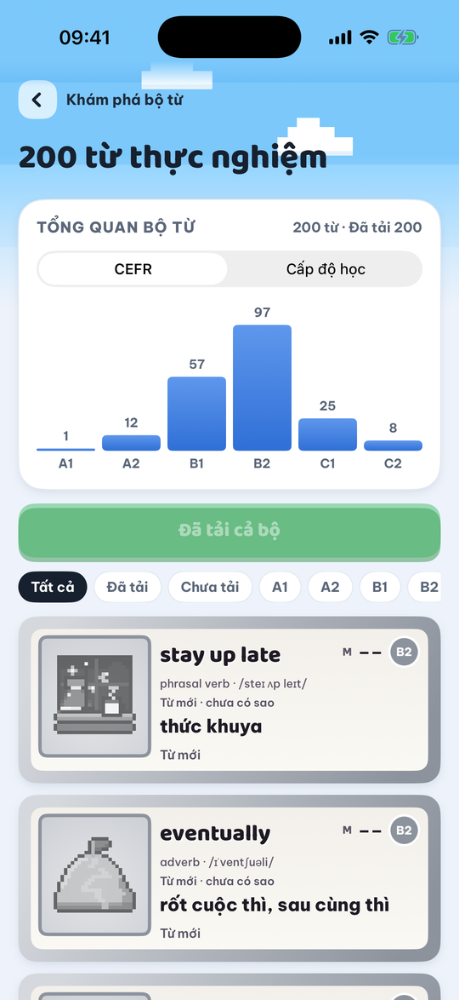 <b>Một bộ thẻ</b></td>
    <td align="center">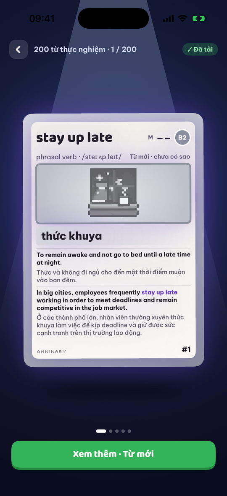 <b>Xem thẻ</b></td>
    <td align="center">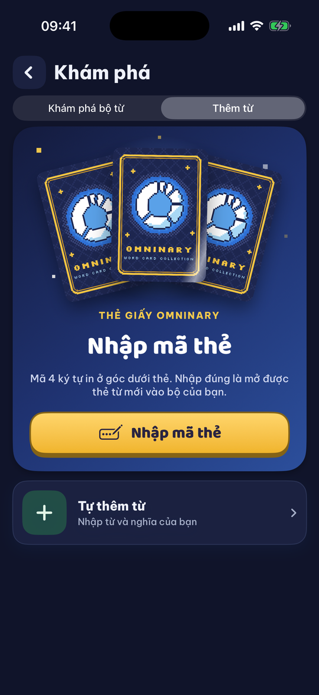 <b>Nhập mã thẻ giấy</b></td>
  </tr>
</table>

### 🧑‍🏫 Ngữ pháp cùng Giáo sư Gram

Lộ trình ngữ pháp sáu bậc theo khung CEFR từ A1 đến C2, hiện đã có các chủ điểm A1 đầu tiên. Giáo sư Gram giảng lý thuyết bằng hoạt hình và lồng tiếng, sau đó là bài tập ba mức Dễ, Vừa, Khó; đạt mức Vừa thì mở chủ điểm tiếp theo.

<table>
  <tr>
    <td align="center">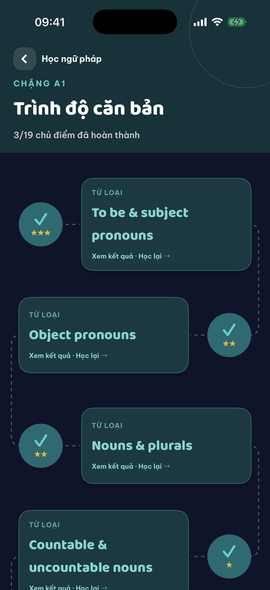 <b>Lộ trình chủ điểm</b></td>
    <td align="center">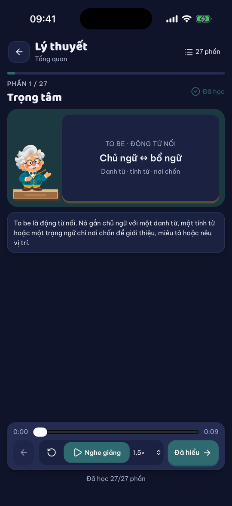 <b>Bài giảng</b></td>
  </tr>
</table>

### 🎧 Luyện nghe và luyện nói

Tải các seri bài nghe, nghe từng câu rồi chép lại với gợi ý từng chữ. Luyện nói theo câu mẫu và nhận điểm chính xác, trôi chảy, đầy đủ, ngữ điệu.

### 🔥 Chuỗi ngày học và bầu trời đổi theo giờ

Home là một bầu trời pixel đổi theo giờ và thời tiết thật, kèm một từ mới mỗi lần mở app. Tab Streak giữ lịch học cả tháng; lần học đầu tiên trong ngày sẽ thắp lại ngọn lửa. Vật phẩm đổi bằng điểm Omni giúp đóng băng hoặc cứu chuỗi, và các biểu tượng app (Omnicon) mở khoá theo mốc chuỗi.

<table>
  <tr>
    <td align="center">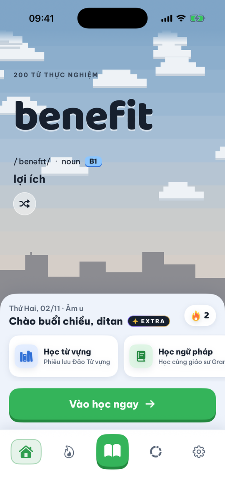 <b>Home ban ngày</b></td>
    <td align="center">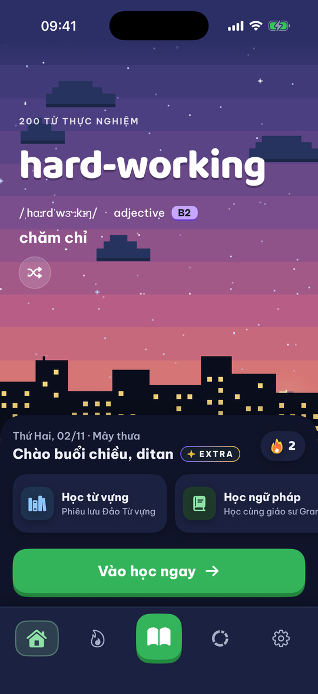 <b>Home ban đêm</b></td>
    <td align="center">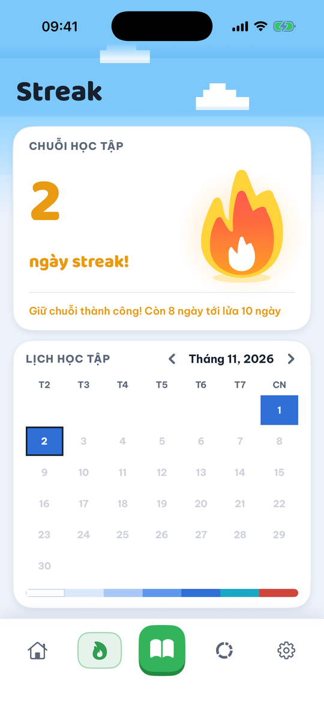 <b>Streak</b></td>
    <td align="center">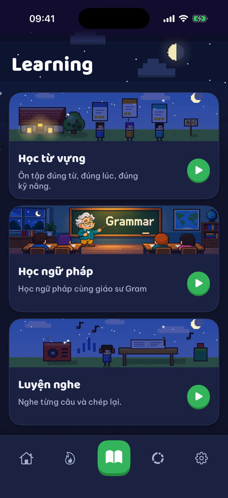 <b>Learning</b></td>
  </tr>
</table>

## Công nghệ

| | |
|---|---|
| **App iOS** | Swift, SwiftUI, iOS 18+ |
| **Backend** | Supabase: Postgres, RLS, RPC, Storage, Auth, Edge Functions |
| **Chấm phát âm** | Azure Speech Pronunciation Assessment qua Edge Function |
| **Đồ hoạ** | Engine pixel tự viết bằng Swift, ảnh thẻ từ 24×24 |
| **Ngữ pháp** | Bài giảng HTML/JS trong WKWebView, học liệu tải theo phiên bản |
| **Web** | React, Vite, TypeScript (`admin-web/`) |

## Chạy dự án

1. Cài **Xcode 26** trở lên.
2. Clone repo rồi mở `Omninary.xcodeproj`.
3. Chọn scheme **Omninary** và một máy ảo iPhone, rồi bấm **Run**.

Cơ sở dữ liệu và Edge Function nằm trong [`supabase/`](supabase/); trang web cho người học và quản trị nằm trong [`admin-web/`](admin-web/).

## Lịch sử phiên bản

| Phiên bản | Nội dung chính |
|---|---|
| **2.2.0** | Lộ trình Phiêu lưu, Nhà nghiên cứu hai tab, Khám phá với thẻ từ pixel và mã thẻ in, ngữ pháp cùng Giáo sư Gram, Home bầu trời và tab Streak |
| 2.1.0 | Thuật toán Extra v1, giao diện pixel mới, Phiêu lưu, Nhà nghiên cứu |
| 1.2.0 | Bản Ditanary phát hành ngày 19/07/2026 |

## Đội ngũ

Phát triển bởi **Tân**, team **1406**, cuộc thi **AISC'26**.
