<div align="center">

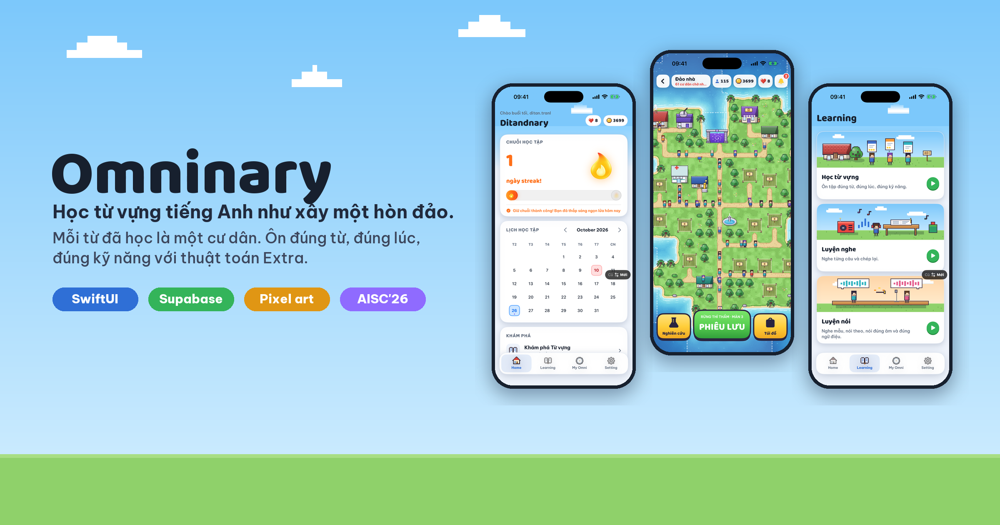

# Omninary

**Học từ vựng tiếng Anh như xây một hòn đảo.**
Mỗi từ đã học là một cư dân. Ôn đúng từ, đúng lúc, đúng kỹ năng.


</div>

---

## Omninary là gì?

Omninary là ứng dụng iOS giúp học và ôn từ vựng tiếng Anh theo lặp lại ngắt quãng (spaced repetition). Mỗi từ được luyện qua năm dạng bài: nghe rồi viết, đọc nghĩa rồi viết, chọn đáp án, sắp xếp câu và đọc to câu ví dụ.

Ứng dụng có hai phiên bản:

| | **Ditandnary** (miễn phí) | **Extraordinary** (trả phí) |
|---|---|---|
| Lịch ôn | Nhịp cố định 1 · 3 · 7 · 15 · 30 · 60 ngày | Thuật toán **Extra** đọc điểm thành thạo M sau mỗi lần ôn |
| Từ yếu | Ôn theo lịch chung | Ôn bù ngay hôm sau |
| Từ vững | Ôn theo lịch chung | Nhảy cấp, dời ra xa |
| Kỹ năng yếu | Không thêm câu | Tự thêm câu cho kỹ năng còn yếu |
| Lượt học | 10 tim mỗi ngày | Không giới hạn |

Thiết kế chi tiết của thuật toán nằm ở [docs/EXTRA_V1_DESIGN.md](docs/EXTRA_V1_DESIGN.md).

## Có gì mới ở bản 2.1

### 🏝️ Đảo nhà
Hòn đảo pixel của riêng bạn, vẽ hoàn toàn bằng Swift. Mỗi từ đã học là một cư dân đi lại trên đảo. Cư dân có từ tới hạn ôn sẽ tới trạm xá chờ bạn, trên đầu hiện tên từ màu đỏ. Bạn dùng điểm Omni kiếm được khi học để xây nhà ở, tiệm bánh, thư viện… và mở thêm 22 vùng đất ven biển.

### ⚔️ Phiêu lưu
Bốn vùng đất gồm Rừng Thì Thầm, Hồ Gương, Phố Chữ và Sa Mạc Vang, mỗi vùng 15 màn. Bạn chọn từ cần ôn rồi vào màn; mỗi nhiệm vụ trên bản đồ là một câu hỏi thật của phiên học. Chấm điểm, lịch ôn và thuật toán Extra giữ nguyên như khi ôn thường. Xong một màn được thưởng thêm điểm Omni.

### 🔬 Nhà nghiên cứu
- **Tiến độ:** số từ đã học, từ vững, từ tới hạn, từ quá hạn, phân bố cấp độ, CEFR và lịch ôn 7 ngày tới.
- **Extra tối ưu:** so sánh lịch cố định với lịch Extra trên chính các từ của bạn, kèm những lần Extra ra quyết định thật.
- **Bộ từ:** mỗi từ là một thẻ bài theo màu CEFR, có sao, điểm M và hình pixel. Thẻ chi tiết có biểu đồ lịch ôn, điểm M, hồ sơ kỹ năng và nhật ký học.

### 🎨 Giao diện mới
Bốn tab Home, Learning, My Omni và Setting được làm lại theo phong cách pixel. Giao diện tự chuyển sáng/tối theo giờ (6:00 đến 18:00 là ban ngày). Nút **Cũ ⇄ Mới** cho phép chuyển qua lại giữa giao diện cũ và mới để so sánh.

## Ảnh màn hình

<table>
  <tr>
    <td align="center">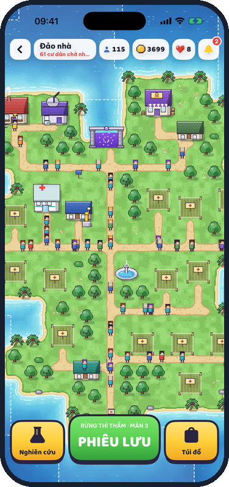<br><b>Đảo nhà</b></td>
    <td align="center">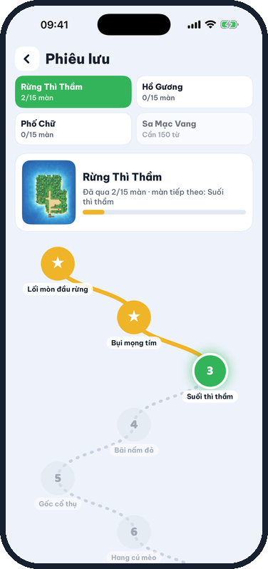<br><b>Phiêu lưu</b></td>
    <td align="center">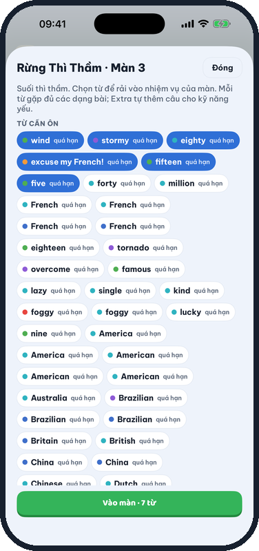<br><b>Chọn từ cho màn</b></td>
    <td align="center">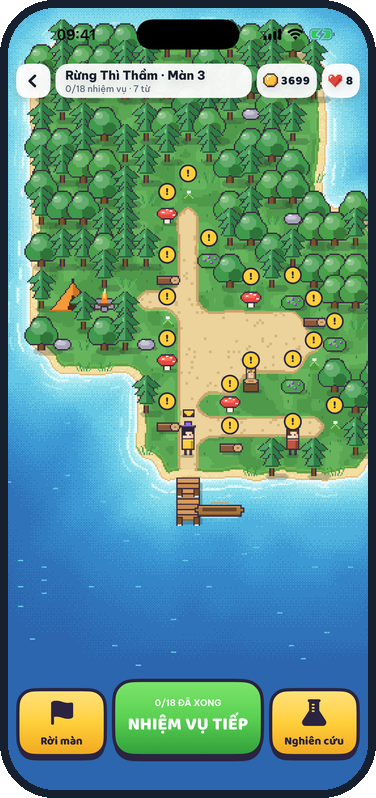<br><b>Màn chơi</b></td>
  </tr>
  <tr>
    <td align="center">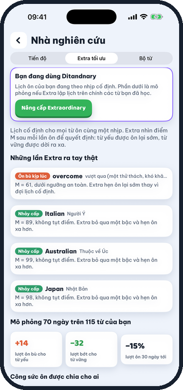<br><b>Extra tối ưu</b></td>
    <td align="center">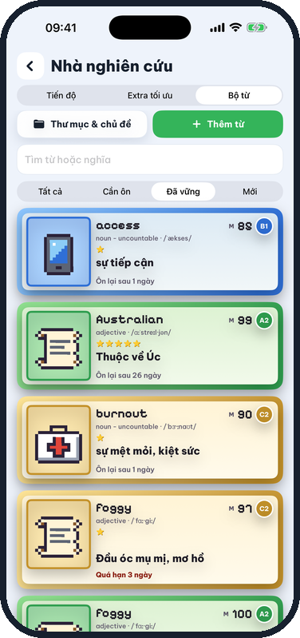<br><b>Bộ thẻ từ</b></td>
    <td align="center">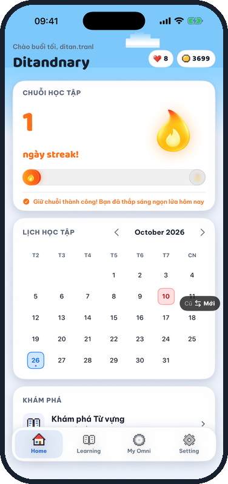<br><b>Home ban ngày</b></td>
    <td align="center">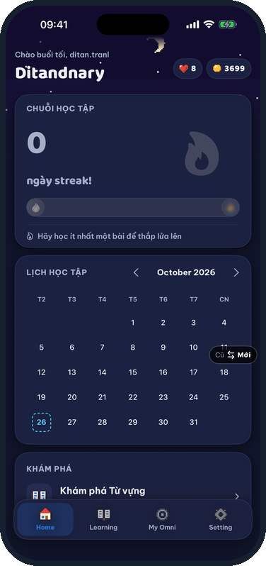<br><b>Home ban đêm</b></td>
  </tr>
  <tr>
    <td align="center">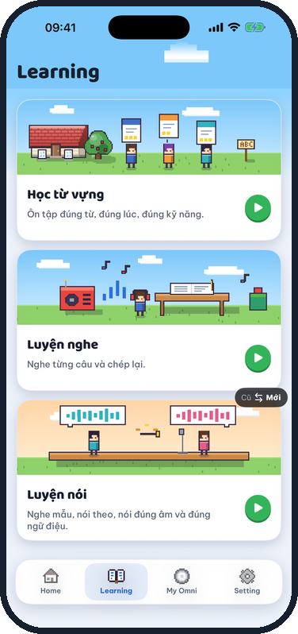<br><b>Learning</b></td>
    <td align="center">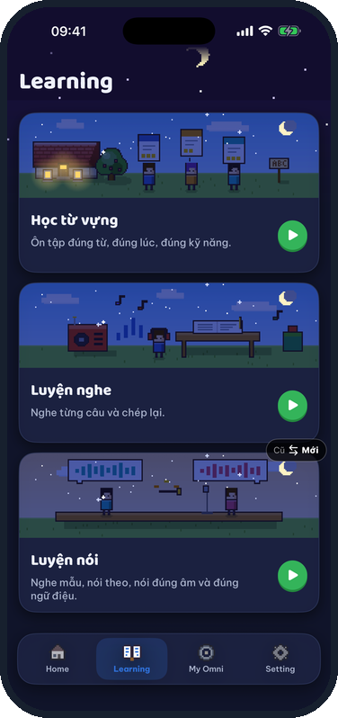<br><b>Learning ban đêm</b></td>
    <td></td><td></td>
  </tr>
</table>

## Công nghệ

| Phần | Công nghệ |
|---|---|
| Ứng dụng iOS | SwiftUI, UIKit (bản đồ đảo), Swift Charts, AVFoundation |
| Đồ hoạ đảo | Engine pixel tự viết bằng Swift: vẽ địa hình, biển động, ban đêm, công trình và 60 màn sinh theo hạt giống (seed) |
| Máy chủ | Supabase: Postgres, Row Level Security, các hàm RPC `SECURITY DEFINER` cho mọi thao tác ghi |
| Trang quản trị | `admin-web` (Vite + TypeScript) |
| Phông chữ | Be Vietnam Pro, Baloo 2, Pixelify Sans, Silkscreen |

## Cấu trúc thư mục

```text
OmninaryApp/
├── Omninary/                 # Ứng dụng iOS
│   ├── Island/               # Đảo nhà, Phiêu lưu, Nhà nghiên cứu và engine pixel
│   ├── OmniV2Theme.swift     # Giao diện mới: màu, phông, icon pixel, ngày/đêm
│   ├── OmniV2Shell.swift     # Bốn tab mới và nút Cũ ⇄ Mới
│   ├── LearningSessionView.swift
│   ├── AdaptiveSessionBuilder.swift
│   └── ...
├── supabase/                 # Migration SQL và kiểm thử
├── admin-web/                # Trang quản trị
└── docs/                     # Tài liệu thiết kế và ảnh
```

## Chạy dự án

1. Cài **Xcode 26** trở lên.
2. Clone repo rồi mở `Omninary.xcodeproj`.
3. Chọn scheme **Omninary** và một máy ảo iPhone, rồi bấm **Run**.

> Bản Debug của target app được build với tối ưu hoá `-O` để engine pixel vẽ đảo trong khoảng một giây.

Các migration của cơ sở dữ liệu nằm trong `supabase/`. Phần đảo và phiêu lưu ở bản 2.1 nằm trong [`supabase/island_adventure_v1.sql`](supabase/island_adventure_v1.sql).

## Lịch sử phiên bản

| Phiên bản | Nội dung chính |
|---|---|
| **2.1.0** | Thuật toán Extra v1, giao diện mới, Đảo nhà, Phiêu lưu, Nhà nghiên cứu |
| 1.2.0 | Bản Ditanary phát hành ngày 19/07/2026 |

## Đội ngũ

Phát triển bởi **Tân**, team **1406**, cuộc thi **AISC'26**.

<div align="center">
<sub>Made with ☕ and a lot of pixels.</sub>
</div>
